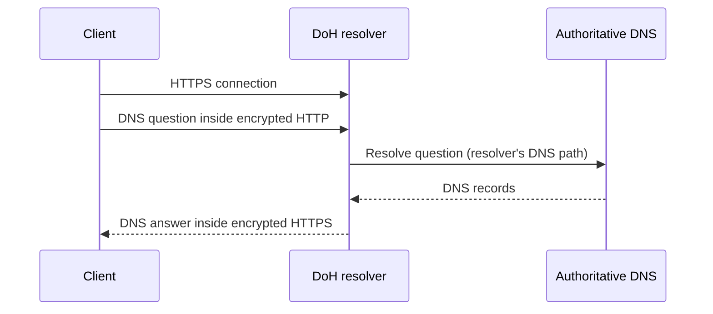

# DNS over HTTPS (DoH)

DoH carries ordinary DNS messages inside HTTPS requests. The client establishes a secure connection to a chosen resolver and exchanges DNS questions and answers through it. This hides the query content from observers on the local network and path to the resolver, while moving trust to the chosen resolver.

## Guarantees and limits

- Protects DNS message contents on the client-to-resolver connection.
- The resolver can still see the questions and may retain or correlate them.
- Observers may still infer the resolver, destination IPs, timing, and traffic volume.
- DoH does not by itself prove that a returned DNS record is authentic; DNSSEC validation is a separate mechanism.
- The client must authenticate the resolver endpoint through HTTPS certificate validation.

DoH generally uses HTTPS on port 443, which can make it blend with web traffic; policy and resolver selection matter.

## References

- [RFC 8484 — DNS Queries over HTTPS](https://www.rfc-editor.org/rfc/rfc8484)
- [RFC 4033 — DNSSEC Introduction and Requirements](https://www.rfc-editor.org/rfc/rfc4033)
