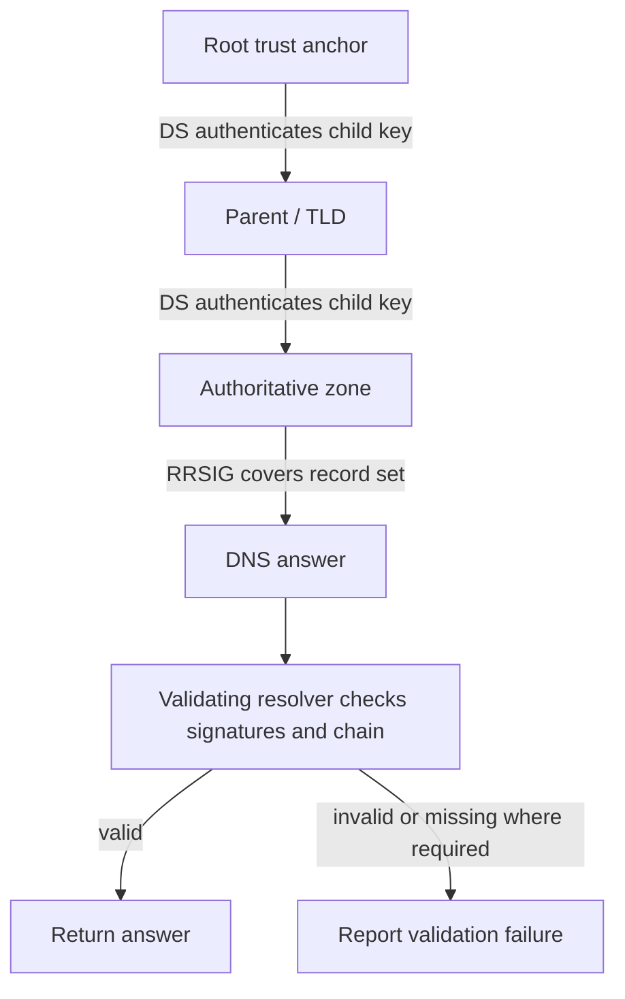

# DNSSEC

DNS Security Extensions add digital signatures to DNS data so a validating resolver can check that records came from the zone responsible for them and were not changed in transit. The resolver verifies a chain of trust from a configured root trust anchor through parent-to-child delegations to the target zone.

## Record roles

- **DNSKEY** publishes a zone’s public key material.
- **RRSIG** contains a signature over a DNS record set (RRset).
- **DS** lets a parent authenticate a child zone key by digest.
- A resolver uses trusted parent data and signatures to validate the answer; a client can receive a validation indication such as the AD bit when using a trusted validating resolver.

## Guarantees and limits

- Detects forged or modified DNS data when validation is performed correctly.
- Does **not** encrypt DNS queries or hide the requested name.
- Does not make the destination itself trustworthy.
- A resolver that does not validate DNSSEC may not provide this protection to its client.
- Misconfigured signatures or expired records can make a domain fail validation.

DoH and DNSSEC solve different problems: DoH protects the client-to-resolver channel; DNSSEC authenticates DNS data.

## References

- [RFC 4033 — DNSSEC Introduction and Requirements](https://www.rfc-editor.org/rfc/rfc4033)
- [RFC 4034 — DNSSEC Resource Records](https://www.rfc-editor.org/rfc/rfc4034)
- [RFC 4035 — DNSSEC Protocol Modifications](https://www.rfc-editor.org/rfc/rfc4035)
