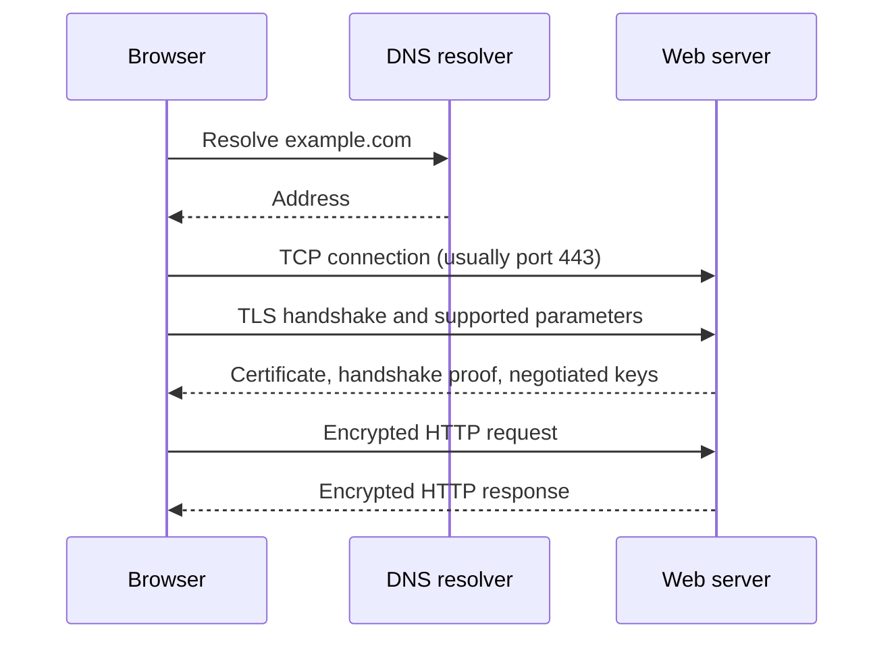

# HTTPS

HTTPS is HTTP carried through a TLS connection. TLS authenticates the server (usually with a certificate), negotiates session keys, and protects application bytes for confidentiality and integrity while they travel between the client and TLS endpoint.

## Mental model

The browser first resolves a hostname and reaches the server. It negotiates TLS, checks the certificate for the requested name and trusted chain, then sends HTTP inside the encrypted channel. The padlock means the connection met browser checks; it does not certify that the site is honest or safe.

## Guarantees and limits

- **Confidentiality and integrity in transit:** network observers cannot ordinarily read or alter protected application records undetected.
- **Server authentication:** certificate validation binds a key to a DNS name under the client’s trust policy.
- **Not anonymity:** the destination IP and some connection metadata can remain visible; DNS privacy depends on the resolver path.
- **Not endpoint security:** malware, browser extensions, server logs, and the website itself can access plaintext at the endpoints.
- **Not inherently end-to-end:** a TLS connection often ends at a CDN, reverse proxy, or load balancer.

HTTP/3 uses QUIC, which incorporates TLS 1.3 handshake machinery rather than TCP plus a separate TLS record layer.

## References

- [RFC 9110 — HTTP Semantics](https://www.rfc-editor.org/rfc/rfc9110)
- [RFC 8446 — TLS 1.3](https://www.rfc-editor.org/rfc/rfc8446)
- [RFC 9001 — Using TLS to Secure QUIC](https://www.rfc-editor.org/rfc/rfc9001)
