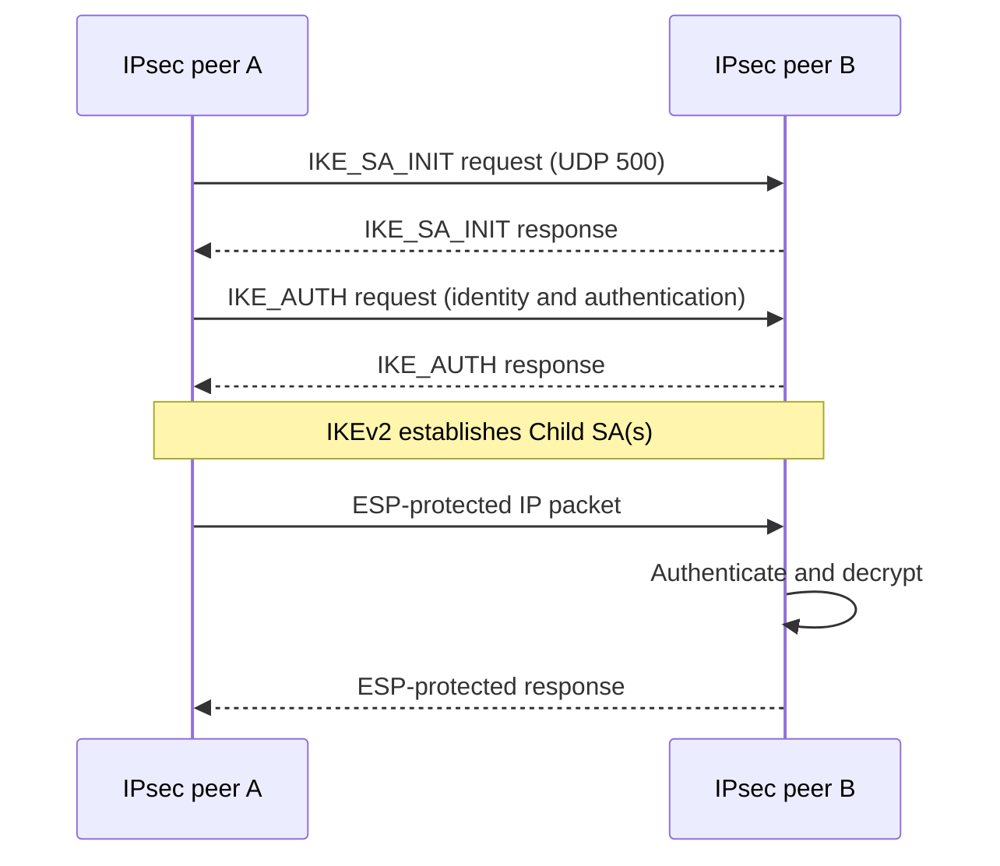

# IPsec

IPsec protects IP traffic at the network layer. A security association (SA) defines parameters for protected traffic. Internet Key Exchange version 2 (IKEv2) negotiates SAs, cryptographic algorithms, key material, and peer authentication. Encapsulating Security Payload (ESP) then protects IP packets according to the negotiated SA.

## Components

- **IKEv2:** control plane for negotiation, authentication, and SA/key management; commonly begins on UDP port 500.
- **ESP:** data plane for confidentiality, integrity/authentication, and anti-replay protection as configured; IP protocol number 50 outside NAT traversal.
- **NAT traversal:** encapsulates ESP in UDP, commonly port 4500.
- **Tunnel mode:** protects an entire inner IP packet between gateways or hosts.
- **Transport mode:** protects the payload of an IP packet while retaining the original IP header.

## Tradeoffs and limits

IPsec can build site-to-site or remote-access VPNs, and support is widely available in operating systems and network equipment. Configuration is more complex than simply enabling encryption: peers need compatible algorithms, identity rules, routing, and firewall policy. Tunnel protection ends at the peer; downstream traffic needs separate protection where required.

## References

- [RFC 7296 — IKEv2](https://www.rfc-editor.org/rfc/rfc7296)
- [RFC 4301 — IPsec Security Architecture](https://www.rfc-editor.org/rfc/rfc4301)
- [RFC 4303 — Encapsulating Security Payload (ESP)](https://www.rfc-editor.org/rfc/rfc4303)
