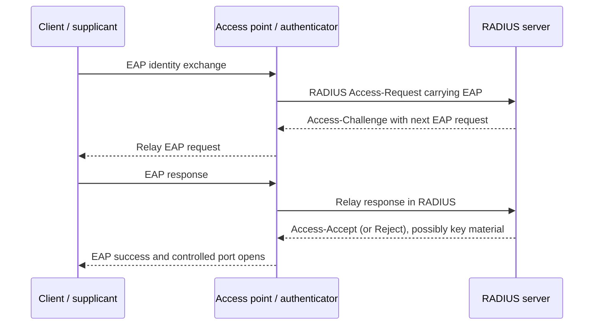

# RADIUS and IEEE 802.1X

IEEE 802.1X controls access to a wired or wireless network port. The endpoint (supplicant) and network access device (authenticator, such as an access point) exchange EAP messages; the authenticator can relay them to an authentication server using RADIUS. The access point enforces the server’s accept/reject result and may install keying material.

## Roles and ports

- **Supplicant:** device seeking network access.
- **Authenticator:** switch or access point controlling the port.
- **Authentication server:** evaluates the chosen EAP method and credentials.
- RADIUS commonly uses UDP 1812 for authentication and 1813 for accounting, though deployments can differ.

The security of the exchange depends heavily on EAP method and configuration. EAP-TLS uses certificates; password-based methods require careful server certificate validation to avoid credential theft. A “trusted network” prompt should not be accepted blindly.

## Limits

802.1X/RADIUS decides whether access is granted; it is not a blanket encryption protocol for all application traffic. Wi-Fi link encryption is separately negotiated after authentication. RADIUS deployments should protect the server path and manage shared secrets or stronger transport protections appropriately.

## References

- [RFC 2865 — RADIUS](https://www.rfc-editor.org/rfc/rfc2865)
- [RFC 3579 — RADIUS Support for EAP](https://www.rfc-editor.org/rfc/rfc3579)
- [RFC 5216 — EAP-TLS](https://www.rfc-editor.org/rfc/rfc5216)
- [IEEE 802.1 working group](https://www.ieee802.org/1/)
