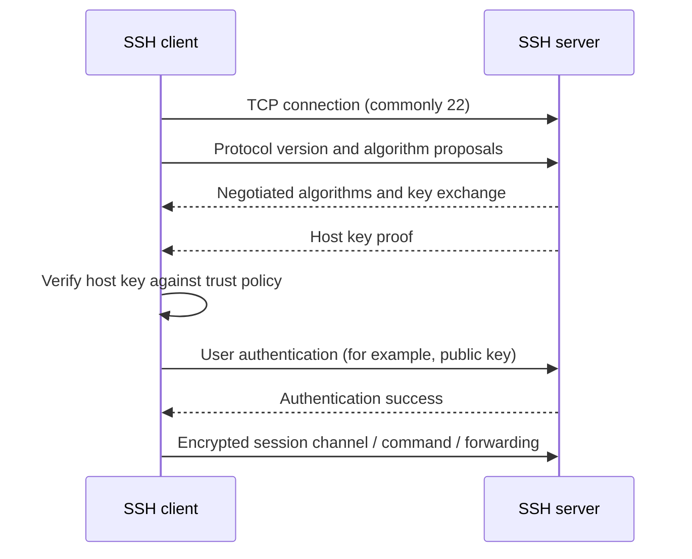

# SSH

The Secure Shell protocol provides encrypted, integrity-protected communication and peer authentication for remote login and related services. SSH commonly runs over TCP port 22. The transport layer negotiates algorithms and keys, authenticates the server host key, and protects later user authentication and session channels.

## Host keys and user keys are different

- **Host key:** identifies the server to the client. On first connection, an unverified trust prompt is vulnerable to a man-in-the-middle attack. Verify the fingerprint through a trusted channel.
- **User key:** proves the client’s identity to the server. Keep the private key protected; a passphrase and agent controls can reduce exposure.

SSH can carry interactive shells, SFTP, and port forwarding. These capabilities do not make the commands, remote host, or forwarded application safe by default.

## References

- [RFC 4251 — SSH Protocol Architecture](https://www.rfc-editor.org/rfc/rfc4251)
- [RFC 4252 — SSH Authentication Protocol](https://www.rfc-editor.org/rfc/rfc4252)
- [RFC 4253 — SSH Transport Layer Protocol](https://www.rfc-editor.org/rfc/rfc4253)
- [RFC 4254 — SSH Connection Protocol](https://www.rfc-editor.org/rfc/rfc4254)
