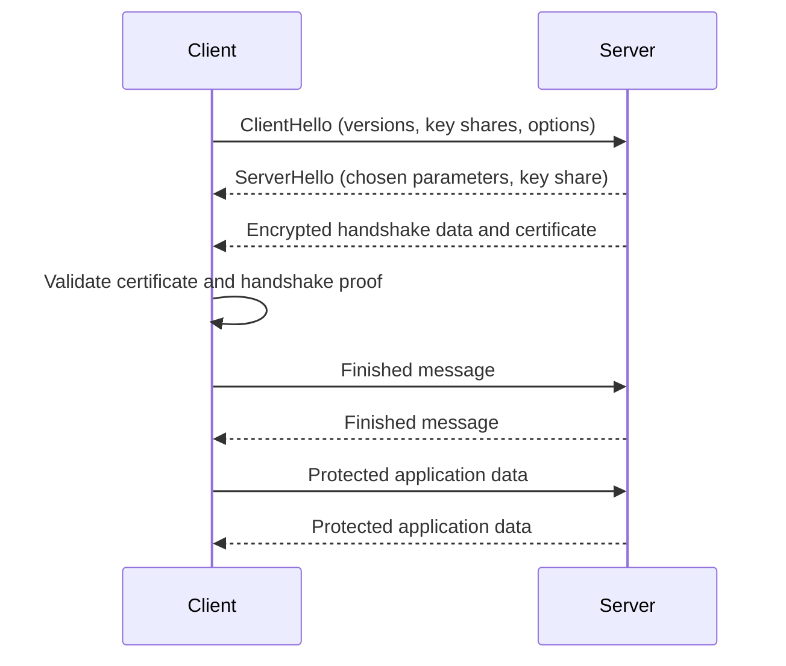

# TLS (and SSL)

Transport Layer Security (TLS) creates a channel that can authenticate a peer, protect data from disclosure, and detect modification. Applications such as HTTPS, mail submission, and APIs use TLS to protect their own protocols.

SSL is the name of the obsolete predecessor family. SSL 2.0 and SSL 3.0 are insecure and must not be used. Modern deployments should use TLS 1.2 or TLS 1.3 with secure configuration; TLS 1.3 is specified in RFC 8446.

## Key concepts

- **Handshake:** negotiates algorithms and establishes fresh session secrets.
- **Certificate validation:** checks the peer identity against names, validity, issuer chain, and local trust rules.
- **Record protection:** encrypts and authenticates application data with traffic keys.
- **Forward secrecy:** ephemeral key exchange can limit the effect of a later compromise of a long-term authentication key.

TLS does not hide every traffic feature: IP addresses, timing, and some handshake metadata may be visible. TLS secures the channel only up to its endpoints; an intercepting proxy creates separate TLS sessions.

## References

- [RFC 8446 — TLS 1.3](https://www.rfc-editor.org/rfc/rfc8446)
- [RFC 8996 — Deprecating TLS 1.0 and TLS 1.1](https://www.rfc-editor.org/rfc/rfc8996)
- [RFC 7568 — Deprecating SSL 3.0](https://www.rfc-editor.org/rfc/rfc7568)
