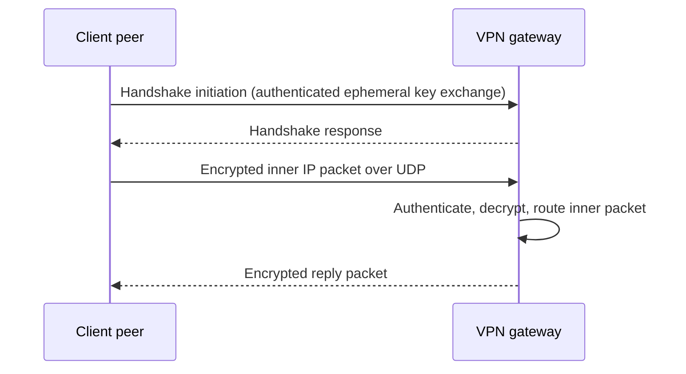

# WireGuard

WireGuard is a layer-3 VPN protocol. It associates peers with public keys and allowed IP ranges, uses a small handshake, and carries encrypted IP packets over UDP. UDP port 51820 is a common default, not a requirement.

## Concepts

- Each peer has a static public/private key pair; the public key acts as its configured identity.
- Configuration binds peer keys to allowed IP prefixes. This mapping also guides routing and source-address checks.
- The protocol uses modern cryptographic constructions, including Curve25519-based key agreement and ChaCha20-Poly1305 authenticated encryption.
- A tunnel protects traffic between the WireGuard peers. Traffic leaving the gateway may be visible to the gateway operator and onward network unless separately encrypted.

## Operational cautions

Protect private keys, constrain allowed IP ranges, keep peer configuration current, and understand split-tunnel routes and DNS behavior. A VPN changes who can observe parts of the path; it does not make the user anonymous by itself.

## References

- [WireGuard — Protocol & Cryptography](https://www.wireguard.com/protocol/)
- [WireGuard — Quick Start](https://www.wireguard.com/quickstart/)
