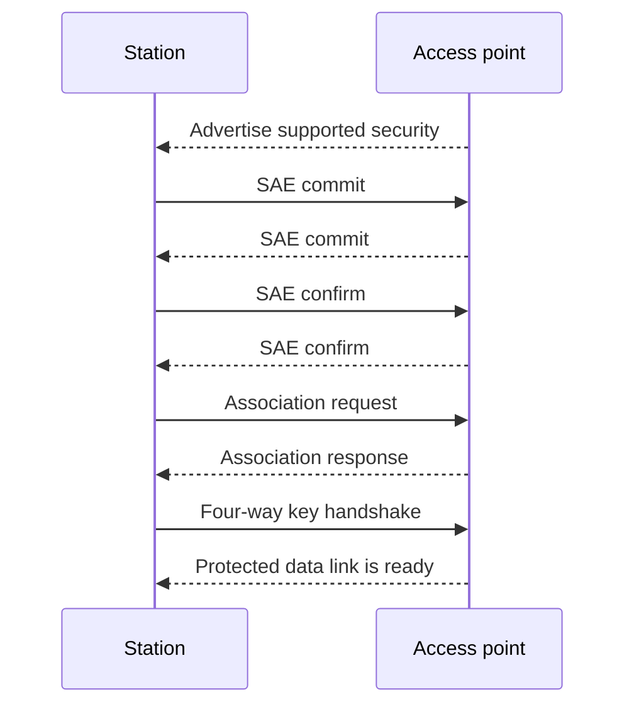

# WPA3

WPA3 is the Wi-Fi Alliance security certification generation for Wi-Fi networks. In WPA3-Personal, Simultaneous Authentication of Equals (SAE) replaces the older PSK-only authentication handshake. SAE is designed to resist offline password guessing from a captured exchange and provides forward secrecy properties when correctly implemented.

## Modes and protections

- **WPA3-Personal:** SAE password-authenticated key exchange.
- **WPA3-Enterprise:** enterprise authentication based on 802.1X/EAP, with stronger security options available.
- **Protected Management Frames (PMF):** required in WPA3, protecting important management traffic against certain forged deauthentication/disassociation attacks.
- A four-way handshake derives and installs traffic keys after authentication.

## Practical limits

A strong, unique passphrase still matters. Legacy compatibility modes can lower security. WPA3 secures the wireless link between the station and access point; traffic beyond the access point needs its own protections such as HTTPS or a VPN. Device implementation and patch level matter.

## References

- [Wi-Fi Alliance — WPA3 security](https://www.wi-fi.org/discover-wi-fi/security)
- [RFC 7664 — Dragonfly Key Exchange](https://www.rfc-editor.org/rfc/rfc7664)
- [IEEE 802.11 working group](https://www.ieee802.org/11/)
